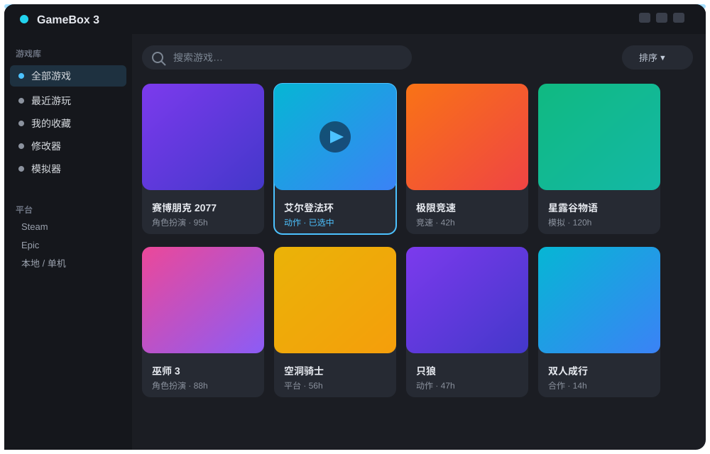
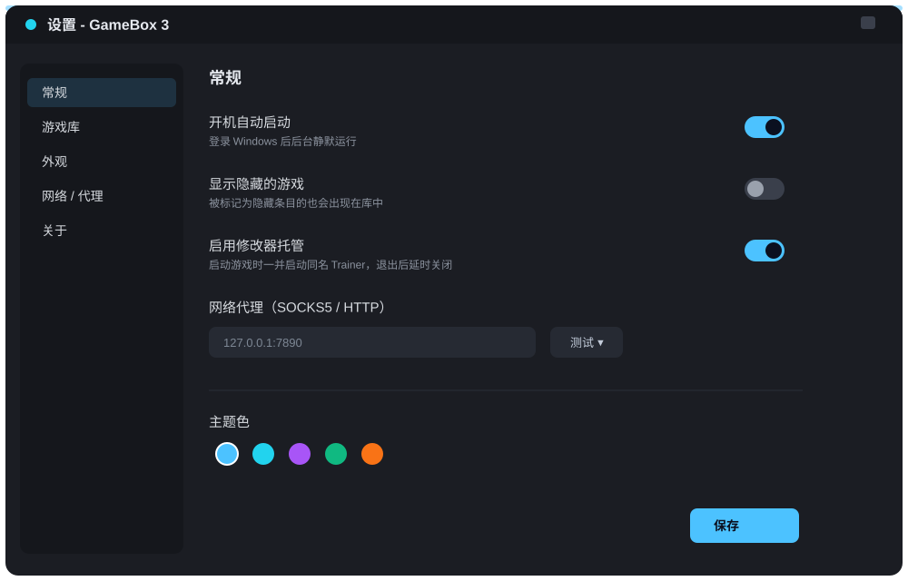

# GameBox 3

<p align="center"></p>

> Windows 原生游戏聚合启动器 —— **Node.js + koffi FFI 直接驱动 Win32 / GDI+**，打包为**单 EXE**，双击即用，不依赖浏览器、不依赖安装。

适用场景：把 Steam 之外散落在多个目录里的单机/盗版/独立游戏统一收纳、自动抓封面、一键启动，并管理"同时只跑一款游戏 + 一个修改器"。

---

## 🤖 Vibe Coding 声明

> **本项目由 AI 辅助（Vibe Coding）生成。**
> 全程通过自然语言对话驱动迭代：没有预先写好的传统规格书，而是由"想法 → 让 AI 写代码 → 运行试错 → 描述问题 → AI 修正"的循环逐步成型。代码由 AI 生成、经人类验收与微调，属于典型的 Vibe Coding 产物。
>
> - 代码风格以"能跑、好读、单文件可维护"为第一目标；
> - 不追求工业级测试覆盖率与完美抽象，重在**快速把想法变成能用的原生桌面程序**；
> - 如果你打算二次开发，建议先读本文档的「[代码注解](#代码注解模块解读)」一节，按模块理解后再动手。

---

## 项目介绍（Introduction）

GameBox 3 是一个**完全用 JavaScript 写出来的 Windows 原生桌面应用**。它不走 Electron / WebView 那条"套浏览器"的路线，而是用 [koffi](https://github.com/kofi/koffi) 这个 FFI 库，直接在 JS 里调用 Windows 的 `user32 / gdi32 / gdiplus` 等系统 DLL，把窗口、按钮、列表、滚动条、弹窗全部用 GDI+ 手绘出来，最后再借助 Node.js 官方的 **Single Executable Application（SEA）** 能力，把整个 Node 运行时 + 源码 + koffi 打包成一个约 85MB 的 `GameBox3.exe`。

它的定位是**单机游戏聚合启动器**：

- 你有很多散落在不同硬盘、不同目录里的游戏（Steam 之外的、独立游戏、备份镜像等）；
- GameBox 3 扫描这些目录，自动识别真正的启动 EXE、抓取 Steam / Bing 封面、查官方中文名；
- 提供 PlayNite 风格的深色游戏库界面，支持鼠标、触屏、Xbox 手柄三种操作方式；
- 启动游戏时强制"单实例"——同时只跑一款游戏 + 一个修改器，切游戏自动结束上一个，避免内存/进程拖沓。

简言之：**用最"重"的方式（手写原生 UI）做了一个最"轻"的工具（单文件、零安装、零依赖）。** 这正是 Vibe Coding 适合发挥的场景——一个清晰的产品想法，通过 AI 一步步把它落成可运行的原生程序。

---

## 技术栈

| 层面 | 技术 | 说明 |
| --- | --- | --- |
| 语言 | **JavaScript / Node.js 18+**（构建用 22.x） | 纯 CommonJS，无编译步骤 |
| GUI 框架 | **自研 Win32 窗口** | 经 `koffi` 调用 `user32 / gdi32 / gdiplus / uxtheme / shell32 / ole32 / shlwapi / comdlg32 / kernel32` |
| 渲染 | **GDI+ 双缓冲**（内存 DC + `Gdip*`） | 软件渲染，不依赖 GPU/浏览器；覆盖圆角裁切 + 预缩放缓存 |
| 输入 | Win32 消息泵 + 原生 `EDIT` + `WM_TOUCH` + `XInput` | 仅搜索/路径/代理框用原生 EDIT（保中文输入法），其余全自绘 |
| 进程管理 | `child_process` + `tasklist/taskkill` + PowerShell `RunAs` | 单实例、启动/结束游戏、修改器看门狗（仅一次 UAC） |
| 网络 | Node 内置 `https/http/net/tls`（**零三方 HTTP 库**） | 自建 SOCKS5 / HTTP-CONNECT 代理隧道；Steam 商店 API、Bing/DuckDuckGo 搜图 |
| 打包 | **Node SEA**（Single Executable Application） | `node.exe` + SEA blob（postject 注入）+ koffi 释放到临时目录 + PE Subsystem 改 GUI |
| 运行时依赖 | 仅 `koffi`（已内联进 EXE） | 打包后**无需安装 Node**；构建期依赖 `koffi`、`postject` |
| 数据存储 | JSON（一游戏一目录 `profile.json`） | 配置 `settings.json`、游戏库 `config/games/*`、日志 `launcher.log` |

一句话：**用 Node 当"胶水层"，通过 koffi 把整个 Win32/GDI+ UI 用 JS 写出来，再用 Node SEA 封成单文件原生程序。**

---

## 架构

```
            ┌─────────────────────────────────────────────┐
            │                  app.js                     │
            │   初始化 → 建窗 → 启动 UI → 消息泵(≈60fps)    │
            └───────────────┬─────────────────────────────┘
                            │ 调用
        ┌───────────────────┼───────────────────────────┐
        ▼                   ▼                           ▼
  ┌───────────┐       ┌──────────────┐            ┌──────────────┐
  │  ui.js    │       │  core.js     │            │ gamepad.js  │
  │ 界面/交互 │◀─────▶│ 数据/进程/网络│            │ XInput 手柄 │
  │ (1993 行) │       │ (1387 行)    │            │ (186 行)    │
  └─────┬─────┘       └──────┬───────┘            └──────┬───────┘
        │ 调用                │ 调用                       │ 事件回调
        ▼                    ▼                           │
  ┌──────────────────────────────────────┐                │
  │           native.js (1283 行)         │◀───────────────┘
  │  Win32 窗口 + GDI+ 渲染 + 输入 + 对话框 │
  │  koffi FFI 封装（所有 *32.dll 声明）    │
  └──────────────────┬───────────────────┘
                     │ 调用
                     ▼
        user32 / gdi32 / gdiplus / shell32 / ... (Windows 系统 DLL)
```

- **分三层**：`native.js`（OS/渲染底座）← `ui.js`（界面与交互）↔ `core.js`（游戏库/进程/网络）；`gamepad.js` 把手柄事件喂给 `ui.js`；`app.js` 负责装配与消息泵。
- **单一主窗口自绘**：整个界面是一块 GDI+ 双缓冲位图；唯一的原生子控件是 `EDIT`（为了中文输入法），其余（按钮、列表、弹窗、滚动条）全部用 GDI+ 画。
- **Node 事件循环与 Win32 消息泵融合**：`PeekMessage` 非阻塞 + `setImmediate(r)` 让出，保证网络请求、定时器、XInput 轮询不卡界面。

---

## 目录结构与源代码清单

```
gamebox3/
├── src/
│   ├── app.js          (52 行)   入口：初始化 FFI → 创建窗口 → 启动 UI → 消息泵（60fps 限帧）
│   ├── native.js     (1283 行)   Win32 + GDI+ FFI 层：窗口/子控件、双缓冲渲染、绘制原语
│   │                           （文字/圆角/椭圆/多边形/封面缓存）、WM_TOUCH 解析、
│   │                           系统选目录/选文件对话框、EDIT 暗色主题、DPI 感知
│   ├── core.js       (1387 行)   游戏库核心：目录扫描 + 主 EXE 智能识别 + 修改器探测、
│   │                           增量扫描、profile 读写、封面搜索（Steam/Bing/DDG）、
│   │                           代理 + SOCKS5/HTTP 隧道、Steam appid/中文名校验、
│   │                           启动与进程托管、修改器看门狗（PowerShell 提权）
│   ├── ui.js         (1993 行)   界面状态/布局/渲染/交互：PlayNite 风格深色游戏库、
│   │                           侧边栏、卡片墙、搜索、排序、设置/重命名/编辑弹窗、
│   │                           Toast、触屏手势（点按/滚动/长按/捏合）、键盘导航
│   └── gamepad.js     (186 行)   XInput 手柄：16ms 轮询、方向键/左摇杆导航（含连发）、
│                               A/B/START 动作、前台门控（后台不响应）
├── tools/
│   ├── build.js       (205 行)   打包脚本：内联 koffi → 生成入口 → 编译 SEA blob →
│   │                           复制 node.exe → PE 去黑窗 → postject 注入 → dist/GameBox3.exe
│   ├── pe-patch.js     (39 行)   PE Subsystem CONSOLE(3) → WINDOWS_GUI(2) 补丁
│   ├── test-touch.js   (248 行)  WM_TOUCH 解析单测 / 调试
│   ├── test-edit.js    (148 行)  原生 EDIT 暗色主题调试
│   ├── test-edit-ui.js (170 行)  编辑弹窗 UI 调试
│   ├── test-modal-hover.js(116行) 弹窗下 hover 冻结逻辑调试
│   └── test-pickfile.js( 79 行)  系统文件对话框调试
├── config/                     运行时数据（封面/游戏库/设置/日志）—— 已被 .gitignore 排除
├── GAMEBOX3功能介绍.html        产品功能介绍页
├── GAMEBOX3经验总结.html        开发复盘（FFI/GDI+/DPI/进程 32 条陷阱）
├── GAMEBOX3综合文档.html        产品 + 复盘合并文档
├── build.bat                   一键打包（自动探测 Node 路径）
├── package.json                构建脚本与开发依赖（koffi / postject）
└── .gitignore
```

> 源码总量约 **4900 行 JS（src/）+ 1000 行（tools/）**，无任何第三方运行时库（koffi 已封进 EXE）。

---

## 代码注解（模块解读）

下面按"从底层到上层"的顺序，对五个核心源文件做逐模块注解，方便二次开发时快速定位。

### `src/native.js` —— OS / 渲染底座（最底层，约 1283 行）

> **职责**：封装所有 Windows API 调用，是整套程序的"地基"。

- **FFI 声明**：用 koffi 把 `user32 / gdi32 / gdiplus / uxtheme / shell32 / ole32 / shlwapi / comdlg32 / kernel32` 的函数签名全部声明出来（含结构体布局，如 `WNDCLASSEX`、`MSG`、`RECT`、`POINT`）。
- **窗口管理**：`CreateWindowEx` 创建无边框主窗口；通过 `SetWindowLongPtr` 挂自定义 `WndProc`，所有鼠标/键盘/触摸/绘制消息都在这里分发。
- **双缓冲渲染**：每张帧都先在"内存 DC + 兼容位图"上用 GDI+ 画完，再一次性 `BitBlt` 到屏幕，杜绝闪烁。封面图按目标尺寸**预缩放缓存**，避免每帧重解码。
- **绘制原语**：封装了圆角矩形、椭圆、多边形、文字（含 DPI 缩放、抗锯齿）、九宫格等常用图元，UI 层只管"画什么"，不碰 GDI+ 细节。
- **输入细节**：解析 `WM_TOUCH` 原始触点做手势；用原生 `EDIT` 控件承载搜索/路径/代理输入框（**关键**：自绘控件拿不到中文输入法，必须借系统 EDIT）；`WM_DPICHANGED` 做 DPI 感知避免高分屏模糊。
- **系统对话框**：封装"选择文件夹 / 选择文件"的公共对话框（`SHBrowseForFolder` / `GetOpenFileName`）。

### `src/core.js` —— 数据 / 进程 / 网络（中间层，约 1387 行）

> **职责**：游戏的"大脑"——扫描磁盘、管理元数据、管进程、管网络。

- **目录扫描与识别**：遍历多个根目录，**智能识别真正的启动 EXE**——按文件名（含 `game/play/launcher` 等关键词）、目录名、文件体积、目录深度打分排序，避开 `uninstall / config / redists` 之类。
- **增量扫描**：记录已扫描目录的 mtime，第二次只处理新增游戏，秒级启动。
- **profile 存储**：每个游戏一个目录 `config/games/<id>/profile.json`，存路径、封面、中文名、是否含修改器等。
- **封面搜索**：依次尝试 Steam 商店接口、Bing、DuckDuckGo 搜图；失败回退首字母占位图；**显式拒绝** GDI+ 解不了的 WebP/SVG。
- **官方中文名**：拿 Steam appid 反查，并用中英文双向校验确认同款、排除 DLC/升级包后才采用。
- **代理隧道**：用 Node 原生 `net/tls` 自建 SOCKS5 / HTTP-CONNECT 代理，搜图/查 Steam 走代理，配置即时生效。
- **进程托管**：`child_process` 启动游戏；`tasklist/taskkill` 做强制单实例；修改器看门狗通过 PowerShell `RunAs` **一次性提权**，游戏退出 3 秒后自动关修改器。
- **幽灵启动防护**：屏蔽注入点击、`isInjectedInput()`、后台节流漏采样，杜绝"游戏退出后误启动别的程序"。

### `src/ui.js` —— 界面 / 交互（上层，约 1993 行，最大文件）

> **职责**：把 `core.js` 的数据画出来，并把用户操作翻译成对 `core.js` 的调用。

- **整体风格**：PlayNite 风格深色游戏库——左侧分类侧边栏 + 右侧卡片墙。
- **布局与渲染**：维护一套布局计算（卡片网格、滚动偏移、悬停态），每帧根据 `native.js` 的双缓冲画完整界面。
- **交互**：鼠标点击/悬停、键盘方向键 + 回车、搜索框过滤、排序（名称/最近玩/大小）、设置/重命名/编辑弹窗、Toast 提示。
- **触屏手势**：点按启动、上下滚动 + 惯性、长按出操作菜单、双指捏合缩放。
- **状态机**：弹窗（modal）打开时冻结底层 hover，避免误触。

### `src/gamepad.js` —— 手柄输入（约 186 行）

> **职责**：把 Xbox 手柄变成"可导航遥控器"。

- **轮询**：每 16ms 用 XInput 读一次手柄状态（不依赖窗口消息，独立线程感）。
- **导航**：方向键 / 左摇杆移动焦点（带连发，长按加速）；A 启动、B 返回、START 打开菜单。
- **前台门控**：仅当 GameBox 3 是前台窗口时才响应，切到别的窗口立刻"装死"，避免误操作别的程序。

### `src/app.js` —— 装配与消息泵（入口，约 52 行）

> **职责**：把上面四块粘起来并驱动主循环。

- 初始化 FFI → 创建窗口 → 实例化 UI 与 Core → 启动游戏手柄轮询。
- **消息泵**：`PeekMessage` 非阻塞取消息，配合 `setImmediate(r)` 让出事件循环，使网络请求、定时器、XInput 轮询不会卡住 UI，整体限帧约 60fps。

### `tools/build.js` + `pe-patch.js` —— 打包（约 244 行）

> **职责**：把源码变成单 EXE。

- 把 `src/*.js` 与 koffi 运行时内联进一个入口文件 → 编译成 SEA blob → 复制到一份 `node.exe` → `pe-patch.js` 把 PE Subsystem 从控制台(3)改成 GUI(2)（去黑窗）→ `postject` 把 blob 注入 → 产出 `dist/GameBox3.exe`。
- koffi 首次运行会释放到 `%TEMP%\gamebox3-koffi-v1\`，无需进仓库。

---

## 功能特性

- **原生单 EXE**：不依赖浏览器，启动即最大化，拷贝到任意目录可跑。
- **多目录扫描**：支持多个游戏根目录，增量扫描只处理新游戏；自动识别真正的启动 EXE（按文件名/目录名/体积/深度打分）。
- **自动封面**：Steam / Bing / DuckDuckGo 多源抓取，失败可手动补搜；自带首字母占位图；拒绝 GDI+ 解不了的 WebP/SVG。
- **官方中文名**：经 Steam 商店 API 校验（中英文反查确认同款、排除 DLC/升级包）才采用。
- **强制单实例**：同一时刻仅一款游戏 + 一个修改器，切换自动结束上一款。
- **修改器看门狗**：游戏退出 3 秒后自动关闭需提权的修改器，全程只需一次 UAC。
- **幽灵启动防护**：屏蔽注入点击、`isInjectedInput()`、`restoreLockUntil`、后台节流漏采样 → 杜绝"游戏退出后自己启动别的游戏"。
- **手柄支持**：XInput，可一键开关，严格前台门控（非激活窗口屏蔽一切手柄操作）。
- **触屏支持**：点按启动、上下滚动手势 + 惯性、长按出操作菜单、双指捏合缩放。
- **代理支持**：SOCKS5 / HTTP，配置即时生效，可测试连通性。
- **数据随行**：配置、游戏库、封面都落在 EXE 同目录 `config\`，便于迁移。

---

## 界面预览（Preview）

> 以下为按照真实界面逻辑绘制的 **UI 原型图**（非运行截图）：左为 PlayNite 风格的深色游戏库卡片墙，右为设置面板。实际界面由 Win32/GDI+ 实时绘制，支持鼠标、触屏与 Xbox 手柄三种操作。

| 主界面（游戏库） | 设置面板 |
| --- | --- |
|  |  |

社交预览图 `assets/social-preview.png`（1200×600，深色霓虹主题）已随仓库提供，可在仓库 **Settings → Social preview** 中上传，作为链接分享时的封面。

---

## 构建（从源码到单 EXE）

> 仅构建机器需要 Node.js；打包结果 `dist/GameBox3.exe` 在目标机器上**无需安装 Node**。

```bash
# 1. 准备（需要 Node 18+，建议 22.x；仅构建期需要）
npm install                # 安装 koffi、postject 到 node_modules

# 2. 打包
npm run build              # 等价于 node tools/build.js / build.bat
# 或双击 build.bat（会自动探测 PATH / WorkBuddy 内置 Node）

# 产物：dist/GameBox3.exe（约 80–90 MB，含内联的 koffi 运行时）
```

要点：
- `tools/build.js` 会把 `src/*.js` 与 `koffi` 运行时内联进一个入口文件，编译成 SEA blob，再注入到复制出的 `node.exe` 中，最后把 PE Subsystem 从控制台改为 GUI（去黑窗）。
- koffi 在首次运行时会释放到 `%TEMP%\gamebox3-koffi-v1\`，无需提交进仓库。

---

## 发布说明（GitHub）

- **仓库**：本项目已发布到 GitHub，源码 + 文档开源，**可执行文件 `GameBox3.exe`（约 85MB）以 GitHub Release 附件形式提供下载**（不进 git 历史，避免仓库膨胀）。
- **许可证**：采用 **MIT**（见仓库根目录 `LICENSE` 文件），可自由使用、修改、再分发，仅需保留版权声明。
- **已加 `.gitignore`**：排除了 `node_modules/`、`dist/`、`config/`（含本地游戏库与封面，属隐私数据）、`*.log`，这些**不会**被提交。
- **封面版权**：自动抓取的 Steam/Bing 封面仅本地缓存展示，源码本身不含任何封面文件（`config/games/*/cover.*` 已被忽略）。
- **"修改器"功能说明**：本程序只是**启动器**——只负责发现并启动你本地已有的 `*.Trainer.exe`、托管其生命周期（退出后延时关闭），**不包含任何作弊代码**。仓库描述已明确这一点，避免被误判。
- **Vibe Coding**：本项目由 AI 辅助（Vibe Coding）生成，详见文首声明。

### 下载与构建

- **直接用**：到仓库的 **Releases** 页下载 `GameBox3.exe`，双击即跑（无需安装 Node）。
- **自己构建**：见上文「[构建](#构建从源码到单-exe)」，需要 Node 18+（建议 22.x），仅构建期依赖 `koffi / postject`。

---

## 免责声明

本工具用于管理**你自己合法拥有**的游戏的本地启动与封面整理。封面来自公开商店接口，仅本地缓存。修改器（Trainer）支持仅为"启动外部程序"的便利功能，程序本身不提供任何作弊内容。请遵守你所在地区的相关法律法规与游戏厂商的 EULA。
